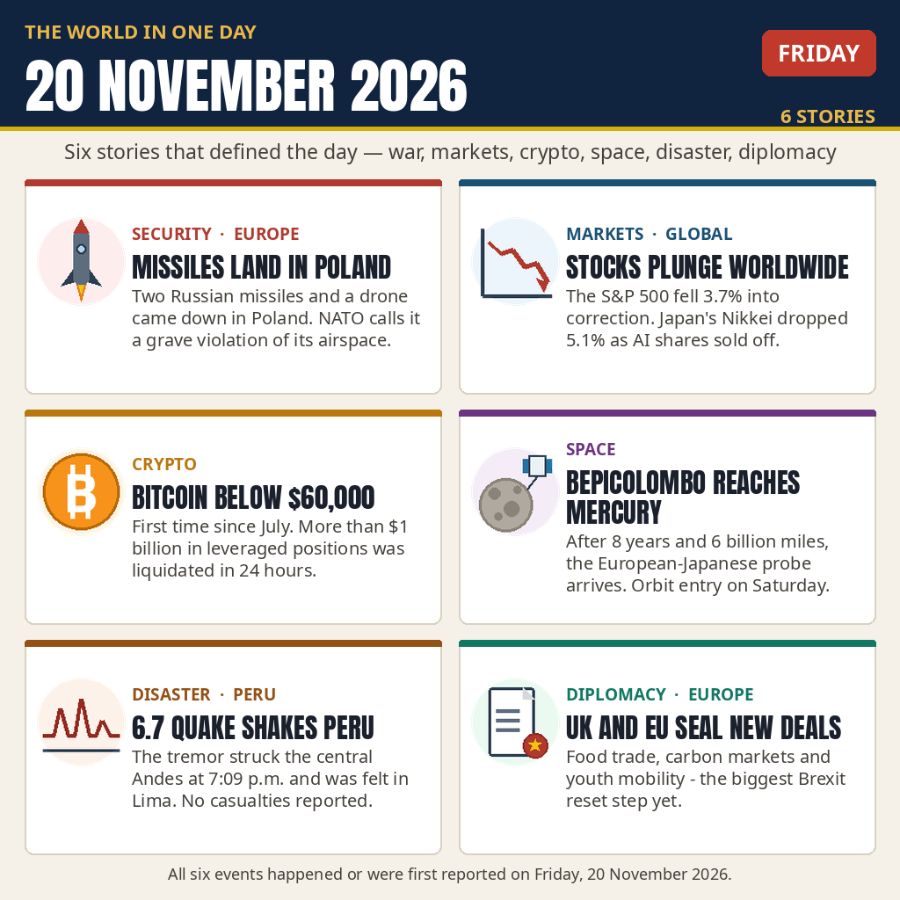

[](https://make.fun/competitions/news-image-20261120)
[](https://make.fun/competitions/news-image-20261120)
[](https://make.fun/competitions/news-image-20261120)

# 20 November 2026 — The World in One Day

An entry for the [make.fun](https://make.fun/competitions/news-image-20261120)
competition **"Sum up 20 November's world news in one image"**.



## The day in six stories

All six events happened, or were first reported, on Friday 20 November 2026:

1. **Russian missiles land in Poland** — two missiles and a drone came down
   in Poland; NATO called it a grave violation of Polish airspace.
   (AP, Institute for the Study of War)
2. **Stocks plunge worldwide** — the S&P 500 fell 3.7% into correction and
   Japan's Nikkei dropped 5.1% as AI shares sold off. (One Turn, Morningstar)
3. **Bitcoin below $60,000** — first time since July; more than $1 billion
   in leveraged positions was liquidated in 24 hours. (TheStreet, CryptoDisrupt)
4. **BepiColombo reaches Mercury** — after 8 years and 6 billion miles, the
   European-Japanese probe arrives; orbit entry on Saturday.
   (The Guardian, Sky & Telescope)
5. **6.7 quake shakes Peru** — the tremor struck the central Andes at
   7:09 p.m. and was felt in Lima; no casualties reported. (USGS, earthquakelist.org)
6. **UK and EU seal new deals** — food trade, carbon markets and youth
   mobility, the biggest Brexit reset step yet. (The Guardian, One Turn)

## How it is made

The image is drawn entirely in code — no photos, no copied artwork.
`draw_image.py` (Python + PIL) draws the header, the six story cards and
all six pictograms (missile, falling chart, bitcoin coin, Mercury probe,
seismograph, sealed document) from shapes, and writes `entry.png`
(1024×1024, PNG).

`main.ts` (Node 22, standard library only) copies `entry.png` to the
output directory. Run it locally with:

```sh
python3 draw_image.py
mkdir -p out && MAKEFUN_OUTPUT_DIR=out node main.ts
```

## License

MIT — see [LICENSE](LICENSE).
